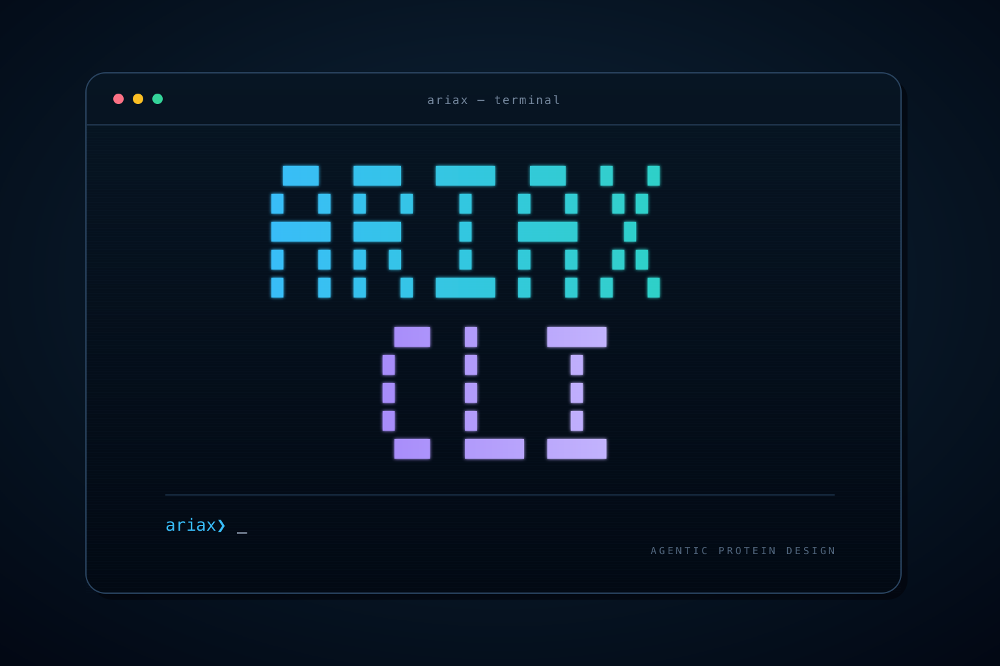

<h1 align="center">Ariax CLI</h1>

<p align="center">
  Run protein-design campaigns from your terminal—or let a coding agent run them with you.
</p>

<p align="center">
  
</p>

<p align="center">
  <a href="https://www.ariax.bio">Website</a> ·
  <a href="https://www.ariax.bio/docs">Docs</a> ·
  <a href="https://www.ariax.bio/settings/api-keys">API keys</a> ·
  <a href="https://www.ariax.bio/pricing">Pricing</a> ·
  <a href="https://www.ariax.bio/contact">Support</a>
</p>

`ariax` is the command-line interface for [Ariax Bio](https://www.ariax.bio),
a platform for running modern protein-design workflows without managing GPU
infrastructure. It prepares inputs, launches projects, follows progress, and
downloads results from your terminal, scripts, or an AI coding agent.

Start with the scientific goal and choose an execution model. **Managed
projects** run a defined workflow: Ariax provisions compute, runs its stages,
reports engine-specific status and results, persists artifacts, and cleans up.
Use one when its live schema supports the experiment. **Forge** provides a
workspace for explicit native commands and composed workflows. You plan the
commands, inputs, output checks, saves, and session closure; Ariax enforces
access, isolation, billing, and the resource lifecycle. Shared engine names do
not imply interchangeable settings or qualification. See
[engine choice](agent-skills/core/engine-choice.md), or run
`ariax skills --reference engine-choice --read --json`.

| Workflow | What you can design |
| --- | --- |
| [BindCraft](https://www.ariax.bio/docs/bindcraft-project-setup) | De novo miniproteins and linear alpha-helical peptides ([agent guide](agent-skills/skills/ariax-bindcraft/SKILL.md)) |
| [BindCraft2](https://www.ariax.bio/docs/bindcraft2-project-setup) | Proteins, peptides, VHHs, scFvs, Fabs, ARPs, oligomers, and multidomain binders ([agent guide](agent-skills/skills/ariax-bindcraft2/SKILL.md)) |
| [BoltzGen](https://www.ariax.bio/docs/boltzgen-project-setup) | Miniproteins, VHHs, linear and cyclic peptides, helicons, and miniproteins targeting small molecules ([agent guide](agent-skills/skills/ariax-boltzgen/SKILL.md)) |
| [PXDesign](https://www.ariax.bio/docs/pxdesign-project-setup) | Diffusion-designed miniprotein binders ([agent guide](agent-skills/skills/ariax-pxdesign/SKILL.md)) |
| [ESMFold2-pipeline](https://www.ariax.bio/docs/esmfold2-pipeline-project-setup) | Miniproteins, VHHs, and scFvs ([agent guide](agent-skills/skills/ariax-esmfold2-pipeline/SKILL.md)) |

## Install

Install [Node.js 20 or newer](https://nodejs.org/), then use the install script
for the latest GitHub build:

```sh
curl -fsSL https://raw.githubusercontent.com/cytokineking/ariax-cli/main/install.sh | sh
```

The latest stable release published on [npm](https://www.npmjs.com/package/ariax-cli)
can also be installed as follows. The npm channel can lag the GitHub build:

```sh
npm install --global ariax-cli@latest
```

Both methods require Node.js and npm. Check your installed version, channel,
and commit with:

```sh
ariax --version
ariax help
```

## Updates

During interactive use, the CLI checks for updates at most once per day. npm
installs check the latest npm release; script installs check GitHub `main` for a
new commit, even when the version number stays the same. It shows a notice when
an update is available. Updates are installed only when you request them:

```sh
ariax upgrade --check    # Check now
ariax upgrade            # Update your current channel, with confirmation
ariax upgrade --yes      # Update without a prompt
```

Automatic checks are skipped in CI, noninteractive commands, and JSON output.
Set `NO_UPDATE_NOTIFIER=1` to disable them.

### Switch between npm and the script install

```sh
ariax upgrade --channel npm       # Switch to the latest stable npm release
ariax upgrade --channel github    # Switch to the latest GitHub main commit
```

You can also rerun either installation command above to switch. Both methods
use the same npm-managed package and `ariax` command, so switching replaces the
existing installation and preserves your login and project files. It works even
when both builds have the same version; switching to npm may select an older
build than GitHub. Future upgrades follow the channel you selected.

Use the same Node.js installation and npm global prefix for both methods. If you
have multiple installations, compare `type -a ariax` with `npm prefix --global`.
For an existing installation under `/opt/homebrew`, for example, target it with
`npm_config_prefix=/opt/homebrew ariax upgrade` (add `--channel npm` to switch).

## Connect your account

Create a key on the [Ariax API keys page](https://www.ariax.bio/settings/api-keys),
then connect the CLI:

```sh
ariax login
ariax me
```

`ariax login` accepts the key in a hidden prompt, verifies it with Ariax, and
saves it in your system credential store. If the system store is unavailable,
the CLI asks before using a user-only credential file. The first authenticated
command can start the same login flow automatically.

Run `ariax logout` to remove the locally saved credential. This does not revoke
the key in your Ariax account. For non-interactive automation, inject
`ARIAX_API_KEY` from your secret manager; it takes precedence over saved login.
Tools that can supply a secret through standard input may use
`ariax login --with-token` as the non-interactive equivalent.
The CLI intentionally does not support `--api-key`, because command-line
secrets can appear in shell history and process lists.

If a key is revoked or rotated, the next authenticated command reports that
Ariax rejected it and exits with code `2`. Follow the printed `action`: create
or copy a new key, then run `ariax login` to replace a saved key. If you use
`ARIAX_API_KEY`, update it in your environment or secret manager instead; it
takes precedence over saved login. The failed command is not replayed
automatically, so rerun it after updating the key.

## Run a managed project

Discover the live API contract, then copy a starter job file:

```sh
ariax protocols
ariax schema bindcraft-v1.5 --raw -o bindcraft-schema.json
ariax skills --read --no-json
ariax skills bindcraft-v1.5 --read --no-json
```

Read the output reference before running if it affects required stages or
saved files; otherwise load it when reviewing results.

Edit `job.json` for your target, then validate it with the structure file.
Validation does not start compute.

```sh
ariax validate -f job.json --input ./target.pdb
```

Once it passes, submit and wait. **Submission starts billable compute.**

```sh
ariax submit \
  -f job.json \
  --input ./target.pdb \
  --name first-bindcraft-run \
  --wait
```

Use the returned project ID to come back later or download results:

```sh
ariax skills bindcraft-v1.5 --reference outputs --read --no-json
ariax status <PROJECT_ID> --wait
ariax results <PROJECT_ID> --download ./ariax-results
```

BindCraft2 jobs can name several target and scaffold files. Put those exact
basenames in one directory and use `--input-dir` with `inputs inspect`,
`inputs prepare`, `validate`, and `submit`. It is mutually exclusive with
`--input`. The prepared directory contains the normalized job, every required
file, and a manifest of byte counts and SHA-256 hashes.

The browser URL is `https://www.ariax.bio/projects/<engine>/<id>`, where the
engine segment is `bindcraft`, `bindcraft2`, `boltzgen`, `pxdesign`, or `esmfold2-pipeline`.

Starter files for all five workflows are in
[`agent-skills/examples/`](agent-skills/examples). Always use `ariax schema`
and the matching agent guide for current fields, target preparation, and
residue numbering.

## Inspect and prepare inputs locally

These commands require no API key. Inspection reads a local structure or downloads
one structure from the fixed RCSB files endpoint (mmCIF by default; PDB when
the explicit job selects BindCraft):

```sh
ariax inputs inspect --input ./target.pdb --json
ariax inputs inspect --pdb 1ABC --json
ariax inputs inspect --input ./target.cif -f job.json --full --json
ariax inputs inspect --input-dir ./bc2-inputs -f bc2-job.json --details --json
ariax inputs prepare --input ./target.cif -f job.json --output ./prepared --json
```

Inspection reports chain IDs, sequence provenance, author/label residue mappings,
unresolved sequence regions, and warnings. With `-f`, `preparation.ready` reports
whether the explicit job can be prepared and lists proposed supported repairs.
Inspection itself does not validate the full server schema. Default console output
omits sequence text and limits mapping rows. BindCraft2 compact inspection reports
only relevant filenames and roles, targets, selected chains or FASTA records,
authoritative chain counts and visible preview truncation, lengths, selector
validation, scaffold edits, and warnings. Use `--full` for
complete sequences and residue maps, and `--details` for manifest hashes, build
identity, and the prior diagnostic field layout; the flags can be combined. Other
protocols keep their released bounded inspection shape, where each chain's
`residue_count` is authoritative and `residues_truncated` marks a preview. For
example, a PD-1 chain with 106 mapped residues can have 85 preview rows. Both
sources have a 10 MB limit. RCSB downloads have a 30-second total timeout;
`--timeout` can lower it. Download redirects are rejected.

Preparation requires explicit protocol and chain selections in `job.json`; it
never chooses target sites or prompts for missing sequences. These are structure-dependent
checks; use `ariax validate` for the live server schema. Preparation writes a new
`input.pdb` or `input.cif`, `job.json`, and `input-manifest.json` into `--output`.
The original input and job remain untouched. An identical repeat succeeds without
rewriting files; a different preparation requires another output directory.
Supported repairs include ESMFold2 author atom IDs/chain IDs and missing PXDesign
polymer metadata. PXDesign PDBs whose full sequence cannot survive its coordinate
converter are rejected: provide canonical mmCIF with the full polymer sequence
and matching author/label identifiers.

The version-1 `ariax_input` manifest records CLI version/channel/source revision,
source and prepared byte SHA-256 hashes, exact source/prepared job hashes, selected
chains, sequence provenance, residue maps, unresolved regions, typed supported
transformations, and preparation notes. File references are relative to the
manifest directory. `sequence_position` is 1-based in the recorded sequence;
author and label numbers remain in their respective coordinate conventions.
Unavailable mappings are `null`, never guessed. Sequences derived from observed
coordinates cannot reveal unresolved terminal residues. The full manifest is
always written even when console output is compact.

Validate and submit the saved pair together. Submission starts billable compute:

```sh
ariax validate -f ./prepared/job.json --input ./prepared/input.cif
ariax submit -f ./prepared/job.json --input ./prepared/input.cif --name prepared-run
```

## Use Ariax with a coding agent

The CLI package includes portable Markdown skills for agents. No MCP server is
required. Run `ariax login` once on the machine where the agent uses the CLI,
then give the agent this:

```text
Use the Ariax CLI for my scientific goal. Verify `ariax --version`, run
`ariax upgrade --check --json`, and tell me if an update is available; do not
upgrade without my approval. Read `ariax skills --reference engine-choice --read --json`
and choose a managed project or Forge for my goal, preserving my
chosen engine and existing compute authorization. Read the selected guide and
the relevant live schema or exact Forge tool and mode qualification. Check
current pricing and prepare the inputs and configuration. For managed work,
validate, submit within my authorized scope, monitor, and retrieve results. For
Forge, plan the native commands, inspect results, complete a checkpoint, close
the session, and verify persistence and resource release. Reconcile uncertain
requests before repeating work. If Ariax is not connected, ask me to run
`ariax login` in my terminal. Never ask me to paste an API key into this
conversation or pass one as a command-line argument.
```

The [shared agent workflow](agent-skills/SKILL.md) covers safe submission,
recovery, monitoring, and downloads. Each protocol guide adds its scientific
capabilities and input rules.

## Command overview

| Task | Command |
| --- | --- |
| Local input inspection/preparation | `ariax inputs inspect --input FILE`, `ariax inputs prepare --input FILE -f job.json --output DIR` |
| Connect or disconnect | `ariax login`, `ariax logout` |
| Account and discovery | `ariax me`, `ariax protocols`, `ariax schema <PROTOCOL>`, `ariax skills [PROTOCOL] [--reference ID] --read` |
| Forge discovery and sessions | `ariax forge catalog --compact`, then `ariax forge catalog --tool TOOL --model MODEL --mode MODE --json`; `ariax forge create`, `status`, `tools`, `run`, `watch`, `close`; read `ariax skills forge --read` |
| Forge inputs and durable outputs | `ariax forge inputs add`, `inputs list`, `inputs status`, `sync`, `checkpoints`, `checkpoint`, `files`, `download`; read `ariax skills forge --reference outputs --read` |
| Current GPU hourly prices | `ariax pricing`, `ariax pricing --json` |
| Validate | `ariax validate -f job.json [--input target.pdb]` |
| Launch | `ariax submit -f job.json --name NAME [--input target.pdb] [--wait]` |
| Recover an attempt | `ariax operations [OPERATION_ID]`, `ariax recover OPERATION_ID [--wait]` |
| Find and monitor | `ariax projects`, `ariax status <PROJECT_ID>`, `ariax jobs --project <PROJECT_ID>` |
| Inspect output | `ariax logs <JOB_ID> --list`, `ariax logs <JOB_ID> --log-ref PATH`, `ariax results <PROJECT_ID> --download ./results` |
| Control a project | `ariax pause <PROJECT_ID>`, `ariax restart <PROJECT_ID>`, `ariax abort <PROJECT_ID>` |
| Inspect run evidence | `ariax runs PROJECT_ID [--job JOB_ID] --json` |
| Read candidate tables | `ariax candidates PROJECT_ID [--view final\|all\|diagnostics] [--all] --json` |
| Export configuration | `ariax projects export PROJECT_ID --output job.json` |
| Change GPU preferences | `ariax gpu-preferences <PROJECT_ID> -f preferences.json` |
| Record project feedback | `ariax feedback <PROJECT_ID> --category technical-support --message "Expected behavior, observed behavior, and actions tried" [--job JOB_ID]` |
| Check or install updates | `ariax upgrade --check`, `ariax upgrade` |

Forge catalog `--compact` routes tool selection; combined status values do not
establish a particular mode. With `--tool`, add `--model MODEL`, `--mode MODE`, or
both to return exact-ID matches with tool/model resources, matching qualification
rows, scope and workload limits, guide, license notices and citations. Missing
rows or status fields and null resources mean unknown. Filters do not establish
support beyond the returned scope. Omit these filters for the full tool record;
`--json` and `--compact` keep their existing output formats. Model/mode filters
cannot be combined with `--compact` or `--details`.

The [RFd4 Forge guide](agent-skills/skills/ariax-forge/tools/rfd4.md) documents a
native joint sequence and structure design workflow. Its checks are bounded;
consult the live catalog for availability, qualified modes and resources.

The [Mol-1 guide](agent-skills/skills/ariax-forge/tools/mol1.md) describes
prepared-JSON molecular prediction, recorded scope and limits. Consult it with
the live catalog before selecting the tool.

For structure-backed BoltzGen jobs, `--input` is required on both `validate`
and `submit`. The `miniprotein-small-molecule` mode has no structure input.

Run `ariax help <COMMAND>` for complete usage. Add `--json` for scripts, and
keep human help output out of the JSON file. The [safe shell example](agent-skills/core/examples.md#safe-scripted-output)
preserves the CLI exit code and stderr before parsing. Submit,
restart, and recovery require an API key with both `read` and `write` scopes.
Before a spending request, the CLI records its original key, exact request, API
origin, account, source hashes, upload intent, and frozen prepared input under
`<root-dir>/.ariax/operations/`. Each attempt has a separate private record;
credentials and signed URLs are excluded.

If a submit or restart reply is lost, use `ariax operations` to find its local
operation ID, then reconcile that retained operation once with
`ariax recover OPERATION_ID`. An `in_progress` result can be followed with
`--wait`, which only polls. If remote reconciliation establishes `state: failed`,
JSON `error.message` includes the operation ID and `state: failed`;
`error.retryable: false` marks that operation terminal, so repeated recovery
cannot advance it. Record the cause, diagnose it, and create a separate fresh
operation only if it fits the user's existing campaign authorization; obtain
authorization for any material change. Never generate a fresh submission
automatically while the first response remains uncertain. Recovery first checks
the actor-owned server record. It replays the saved request with the same key only
when no record exists within the retention window, or the server permits reclaiming
an unstarted lease. `202 in_progress` remains recoverable even before a project ID
exists. Waiting never replays a request. Changed existing source files, prepared
bytes, accounts, or origins block replay; deleted original files can be recovered
from the frozen request and input. After the server's seven-day retention window,
inspect the project before creating a new attempt: the old key cannot safely be
replayed.

Interrupting `--wait` leaves remote work running. Continue with
`ariax recover OPERATION_ID --wait` or `ariax status PROJECT_ID --wait`.
Existing `resume.json` files still work with `ariax status --resume --wait` and
`ariax submit --resume`; new status waits are stored separately per project.
Operation records remain available after completion for reconciliation. Their
`completed` state means the create/restart request completed, not that the compute
job finished; use project status to track compute.

Use `ariax pricing` to check current hourly prices, or `ariax pricing --json`
for the API rates and pricing source. Prices are USD per complete allocation-hour.
Turbo hourly pricing is `single-GPU hourly price × GPU count`.

`data.rates[].hourly_rate` is the current CLI price for the complete GPU allocation.
Use `standard_hourly_rate` for comparison and `promotion` metadata for the offer
label, active flag, and dates. The server selects the price and handles expiry.
Read `quote_is_binding` and `rate_lock_event` before estimating cost; recheck
prices for a new allocation or restart. Existing allocations retain their
recorded rate. Launching through the website or an unmarked API client can
change eligibility.

Choose as many compatible GPUs as the user's memory and hourly budget limits
allow to improve availability. A single compatible core GPU is accepted with an
availability advisory; limited-only selections are rejected. Core choices are
`H100`, `A100_80GB`, `L40`, `L40S`, `RTX6000PRO` for BindCraft, BindCraft2, and
BoltzGen; PXDesign excludes `RTX6000PRO`; ESMFold2-pipeline permits `H100`,
`A100_80GB`, `RTX6000PRO` as core. `A100_40GB`, `A6000`, `H200`, and `B200` are
supplemental, not core. The live schema defines full compatibility and defaults;
memory requirements still apply. `allowed_gpus` lists alternatives for one
allocation, while `priority_mode` ranks them; it does not enable Turbo or raise
GPU count. Keep an existing project's saved or user-specified selection unless
replacement is authorized.
If no core class fits, explain the budget or memory conflict; correct invalid
saved policies with `ariax gpu-preferences` before restart.

Plan campaign scope with a representative pilot or comparable prior campaign
evidence. Before that evidence exists, report hourly prices and runtime
uncertainty; afterward, use observed work, runtime, and recorded costs for a
qualified forecast before scaling. Design counts and trajectory caps bound work,
not exact dollar spend. Preserve explicit small tests and existing authorization.
See [campaign planning](agent-skills/core/campaigns.md) for pilot suggestions and
forecast limits.

GPU preference files replace the saved allocation policy, for example:

```json
{"priority_mode":"cost","allowed_gpus":["H100","A100_80GB"],"turbo_mode":false,"turbo_multiples":[]}
```

`priority_mode` and `allowed_gpus` are required. Omitted `turbo_mode` defaults
to `false`; when it is `true`, omitted or empty `turbo_multiples` selects
`[2,4,8]`. Preferences apply to the next provisioning attempt. Saving them
does not change active GPU instances or restart the project.

Only paused projects can be restarted. Failed projects cannot be restarted;
inspect retained worker logs and contact support@ariax.bio.
`ariax recover` reconciles an uncertain create/restart request, rather than
restarting failed compute.

While provisioning is in progress, poll the same project. For a clearly
restartable provisioning pause, the default is one delayed retry within existing
authorization, then support if it recurs; follow explicit user and server guidance.
Also seek support for failures with missing logs or no supported correction,
inconsistent public status/results/allocation evidence, or an unconfirmed stop.
Include available project/job and operation/request IDs, CLI version, the command
and public error, expected behavior, and actions tried. Omit credentials, signed
URLs, and unnecessary input or log dumps. See the
[shared recovery and support guide](agent-skills/core/managed-projects.md#provisioning-and-job-failures).

Record project-related feedback with `ariax feedback`, using the category
`technical-support`, `feature-request`, or `other`. It requires a write-scoped
API key. Each successful submission returns a feedback ID. For assistance, email
support@ariax.bio with that ID and the project ID.
Recording feedback does not create a support ticket or send email. Keep
messages concise (up to 8 KiB of UTF-8 text), and omit credentials, signed
URLs, and unnecessary scientific inputs. See the
[feedback guide](agent-skills/core/feedback.md), also available through
`ariax skills --reference feedback --read`.

To diagnose a job failure:

```bash
ariax status PROJECT_ID
ariax logs JOB_ID --list
ariax logs JOB_ID --log-ref logs/design_workers/WORKER.log --tail 200
```

The default log is a campaign/run summary. Use the returned worker `log_ref`
for detailed failures. Logs are bounded; increase `--tail` (up to 5000) or
retrieve the relevant saved log when a summary is insufficient.

Use `ariax results` to list available output files. `--path` selects an exact
file or directory; globs and partial prefixes are unsupported.

```sh
ariax results PROJECT_ID --path output/Trajectory --download ./results
```

Rerun the same download to resume. Add `--details` for diagnostic and provenance
fields. Download summaries report the local destination; BindCraft2 archives
use a project-specific filename. See [results and errors](agent-skills/core/managed-projects.md#results-and-errors)
for recovery and [SECURITY.md](SECURITY.md) for data handling.

## Repository structure

```text
ariax-cli/
├── bin/                 executable entry point
├── src/                 commands, API client, and local input preparation
│   └── commands/        one module per CLI command
├── test/                CLI integration helpers and scientific checks
├── agent-skills/
│   ├── SKILL.md         shared agent workflow
│   ├── skills/          protocol-specific guides
│   ├── examples/        starter job configurations
│   └── core/            raw REST fallback
├── .github/workflows/   CI and releases
└── install.sh           public GitHub-hosted installer
```

The CLI requires Node.js 20+. Its only optional runtime dependency integrates
with the operating system's credential store. See the contribution guide for
package integration checks.

See [CONTRIBUTING.md](CONTRIBUTING.md) to contribute. The CLI and agent skills
are available under the [Elastic License 2.0](LICENSE).

## Settings and result guides

Use `ariax runs PROJECT --json` for recorded job settings and
`ariax projects export PROJECT --output job.json` to save a reusable job spec.
Keep the original inputs separately; export does not download them. See
[recorded settings and reuse](agent-skills/core/recorded-settings.md).

Use `ariax candidates PROJECT --all --output candidates.json --json` to export
candidate metrics, sequences and structure paths. See
[candidate views and pagination](agent-skills/core/candidates.md).

For BindCraft2 properties, amino-acid preferences, saved structures and
continuation, use the [protocol guide](agent-skills/skills/ariax-bindcraft2/SKILL.md)
and [output guide](agent-skills/skills/ariax-bindcraft2/outputs.md).
